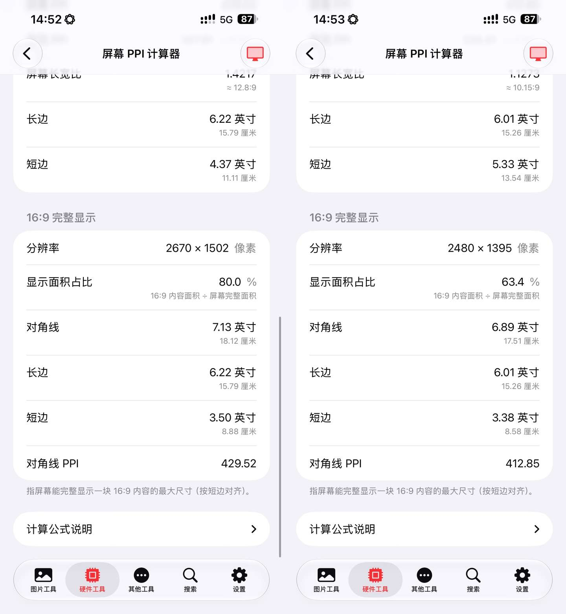
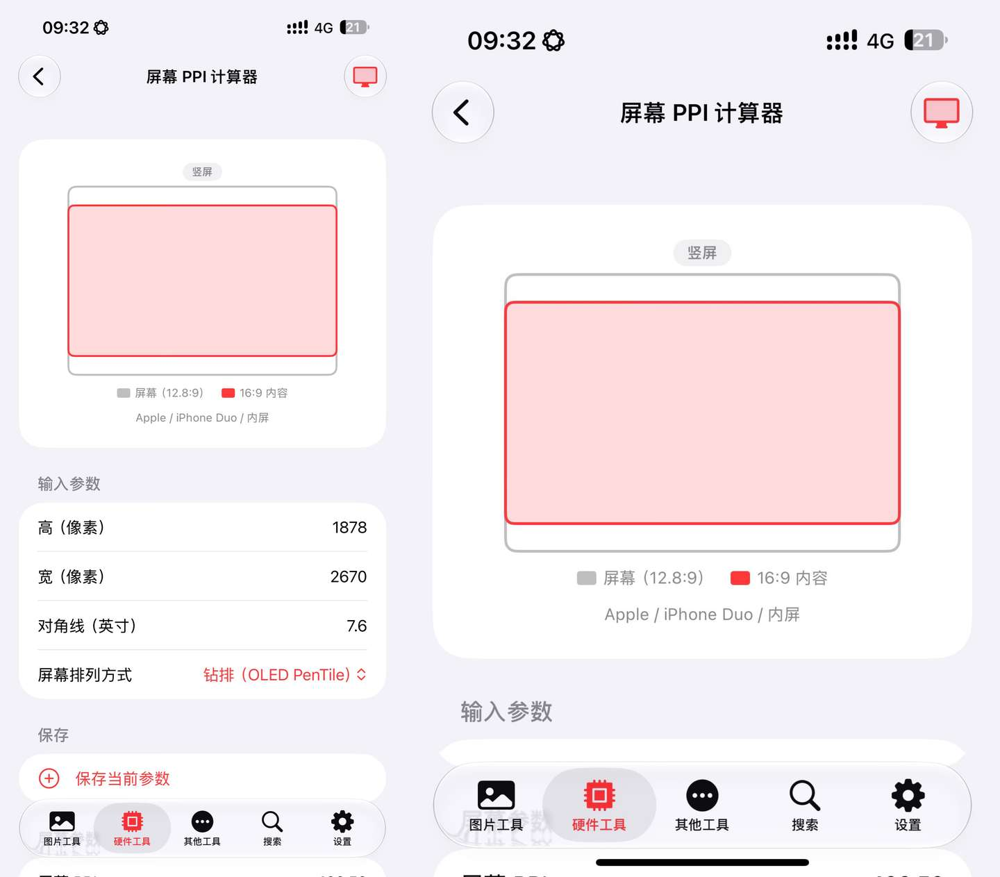
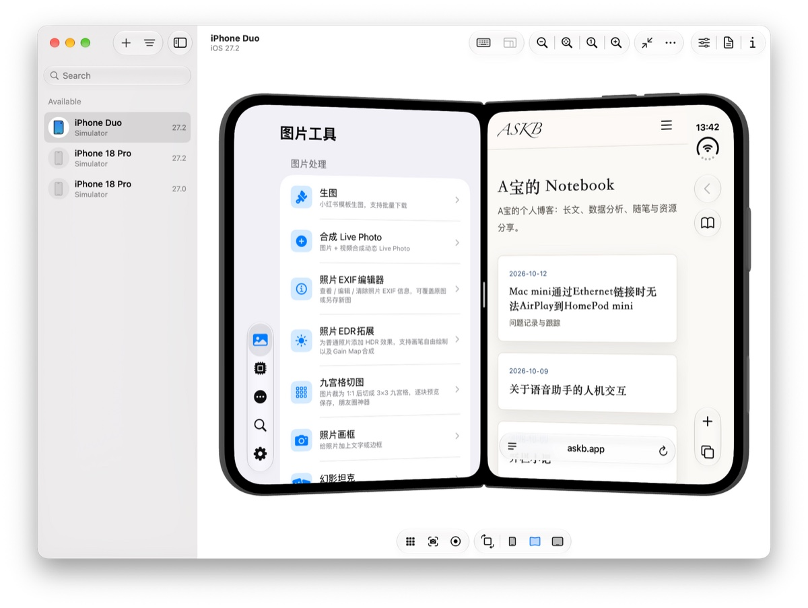
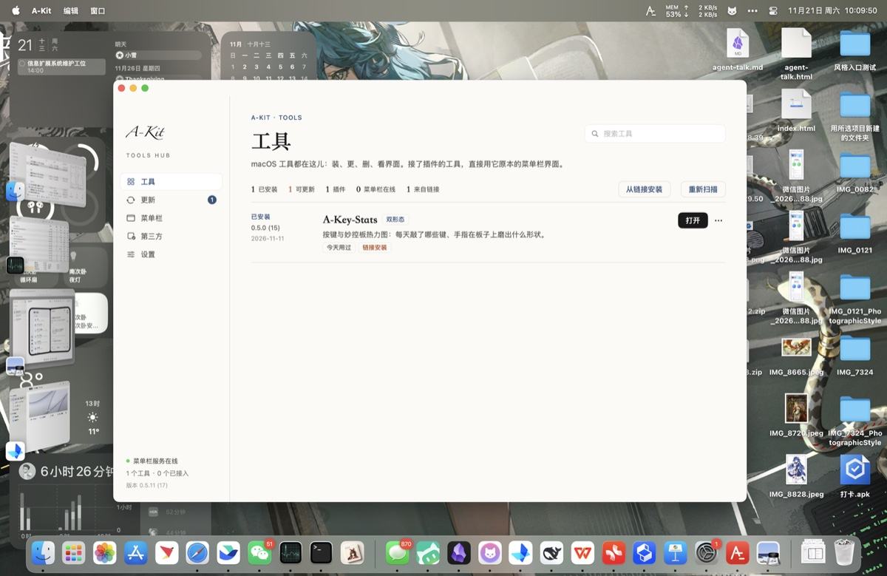
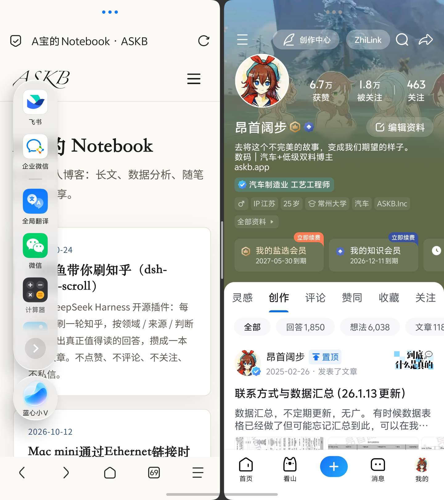

很难评的一台 iPhone。

但是难评主要是难评在了三个方面：

1. 品控缺陷。
2. 目前软件的适配方案仍未达到理想预期。
3. 品类形态问题。

品控缺陷其实算是一切的导火索，如果没有这个问题舆论其实不会这么爆炸，或者说后面的问题在目前折叠的生态里就不是问题。

## 「宽折叠」这个品类

我们先说回来「宽折叠」[^1] 这个品类，其实就是想要试图解决「大折叠」[^2]内屏在娱乐时屏幕利用率不高的问题。

上图左侧为「宽折叠」iPhone Duo，显示 16:9 内容时等效屏幕尺寸为 7.13 英寸。右侧为「大折叠」，以我目前的工作机 vivo X Fold3 Pro 进行计算，显示 16:9 内容时等效屏幕尺寸为 6.89 英寸。「宽折叠」确实显示面积会更大，但也没有大多少，这里主要是观感上的提升，即上下黑边宽度的缩减，但显示面积上两者均要比 iPhone Pro Max 这样的直板机还要大不少。

## 外屏与软件适配

但是「宽折叠」的问题在于，为了保证内屏的显示面积和填充率，缩减了外屏的体验，尤其是纵向高度。如果对底部导航栏、顶部状态栏完全不加修改，最后的结果就类似这样的：

右侧为模拟宽折叠比例在外屏对于页面的显示效果，实际上类似的东西你们也见过不少，落实到具体场景就是：同屏显示更少条数的信息流、聊天记录、外屏只能显示被裁切的短视频画面等等……

所以势必就要对软件的适配逻辑进行修改。苹果给出的方案是将摄像头挖孔、状态栏、底部的导航栏以及一些编辑、返回等的按钮全部移动到屏幕右侧或者左侧[^3]。以保证外屏主界面依旧有一个完整的 16:9 显示比例，从而维持同屏的内容展示量。那么这套逻辑的问题其实并不在于左撇子右撇子这些，而是在于将高频交互的屏幕控件进行移动，在实际使用中还会因为灵动岛等进行避让偏移，导致很难形成有效的场景肌肉记忆。

适配和开发层面倒是一如既往地展现出了 iOS 对于生态的把控力，乃至于这次 Apple 甚至罕见地直接把主流软件厂商飞到库比蒂诺来协作适配，要知道当年从 Intel 转到 Apple Silicon 的 Mac 都没现在这个待遇。

至于说「没有提前拿到开发套件」等说法就是纯纯搞笑了，且不见发售这段时间来主流软件的适配进度。而在整体的适配上，如果采用系统原生的控件进行开发，那么基本就没什么好担心的，导航栏和按钮会自动偏转，窗口尺寸的变化以及单 App 打开多个窗口的接口都是跟着 iPad 走的。

开发套件是从 Duo 的发布会就开始提供了 Xcode Beta 版本以及对应的 simulator、Developer 文档，前前后后也有小一个月，再借助 AI Agent 的能力你说你不好适配吗……

只能说这块形态做得其实并不怎么好，但也没什么好招，Apple 尚且如此。因为友商们的「宽折叠」在这块选择了直接摆烂，索性放弃外屏的同屏内容展示量。

## 转到内屏

iPhone Duo 的差距和安卓这边就逐渐开始展现了。

首先是 iPhone 并没有完全搬过来「iPad经典分屏」[^4]的逻辑，导致其实缺失了对于内屏 App 比例自由调整的能力，也没拿过来侧拉功能。导致你要么就是全屏，要么就是像我上图一样二分屏。同时因为「侧边栏」长期的缺失，导致其实并不是很好切换软件。

而且这里还出现一个更严重的问题，就是在桌面时，屏幕右侧显示的是「Dock 栏」，打开程序之后会被「导航栏」替换掉。这在外屏使用时还不算问题，但是在内屏就很难绷了。

自己做的另一个小东西，[A-Kit Tools Hub](https://github.com/BacheLor11/A-Kit-Tools-Hub-macOS)，已经开源。

想象一下你在使用 macOS 的时候，顶部的菜单栏和底部的 Dock 会被系统"智能"的切换显示。安卓和 iPadOS 都有完整的软件切换逻辑，安卓这边有侧边栏，iPadOS 可以拉出 Dock。iPhone Duo 给你的方案就很拧巴，即上滑关闭 App 不会直接回到主界面，而是关掉一侧的 App 显示桌面让你继续打开。

这个问题继续延伸，就是当你从外屏切换到内屏时，缺少有效的并行入口，因为系统很难感知到你到底是想并行两个 App，还是想要给外屏使用的 App 更好的内容展示。所以各家展开之后都是先让外屏的 App 继续在内屏全屏展示，这时候你想要切换到多窗口，在 Duo 上就比较要命了，你只能先退出，然后选择第一个 App 长按选择以分屏打开，再去打开第二个 App。

只能说完全丢失了 iPad 以前的优雅与流畅，而且还白瞎了 iOS 一贯的全局拖拽和无障碍布局。

在内屏应用的全屏显示[^5]上，iPhone Duo 依旧延续了外屏的逻辑，这样就不会有硕大的雷霆导航栏，没有经过适配的软件则显示为 16:9。相较于暴力拉伸我认为算是比较满意的方案。

## 硬件层面

转轴是彻底寄了，评价为真不如国产。至于磨砂膜我的态度和大部分人则不同。

因为只要你用过任何折叠屏就都会知道，内屏都是会附带贴膜而且明确要求不能私自揭掉和附加贴膜的。那么可以说「纳米纹理表层」本身就是显示效果设计的一部分，就如同你也不会把你显示器、电视表面的磨砂层或者抗反射层故意剥掉一样。所谓"揭掉膜还不如安卓折叠"本身就是个很抽象的操作。你还不如说把汽车轮胎花纹去掉刹不住车呢。

另一层面，我确实也不喜欢 Duo 的内屏处理方式，我个人更喜欢传统的镜面 AR 抗反内膜，磨砂属于是别人会觉得折痕很浅但是自己不怎么在乎的东西，而且和外屏也事实上形成了显示差距。

此外的硬件层面倒没什么好说的，无论是亮面钛金属边框搭配双表面工艺的 3D 冷雕玻璃背板、悬停角度、背部内嵌的磁铁等等都是很提升质感的。

关于「宽折叠」本身，在 Apple 也只能拿出现在的答案之后，我的评价就是：

因为「大折叠」起码给你提供了一个传统直板比例的外屏来规避适配问题。至于友商的几个「宽折叠」，那也是各有各的大病，直接开摆了说是。

你在这种情况下明知道屏幕比例有问题，你问我适配怎么办，那起码还有人愿意探索一下方案。

以上。

[^1]: 我不想采用「阔折叠」或者说是「中折叠」这些称呼，因为按照开发期间的一些消息来看我们知道 iPhone 做这个比例其实是在友商之前。

[^2]: 传统大折叠。

[^3]: 这取决于分屏的状况，展开内屏分屏时，左侧软件的导航栏按钮也会移动到左侧。

[^4]: 我习惯叫 iOS 9 到 iPadOS 18 的简易分屏 + 侧拉为 iPad 经典分屏。

[^5]: 内屏分屏跳过，和外屏一样。
